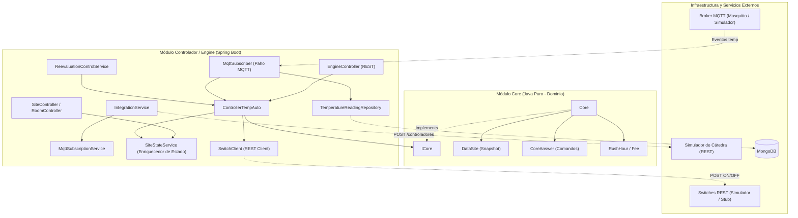
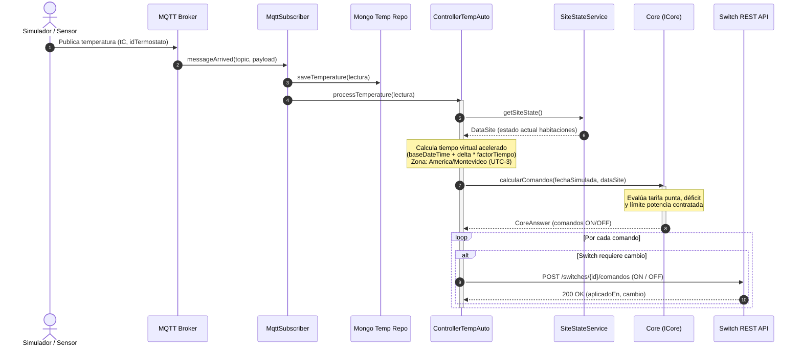
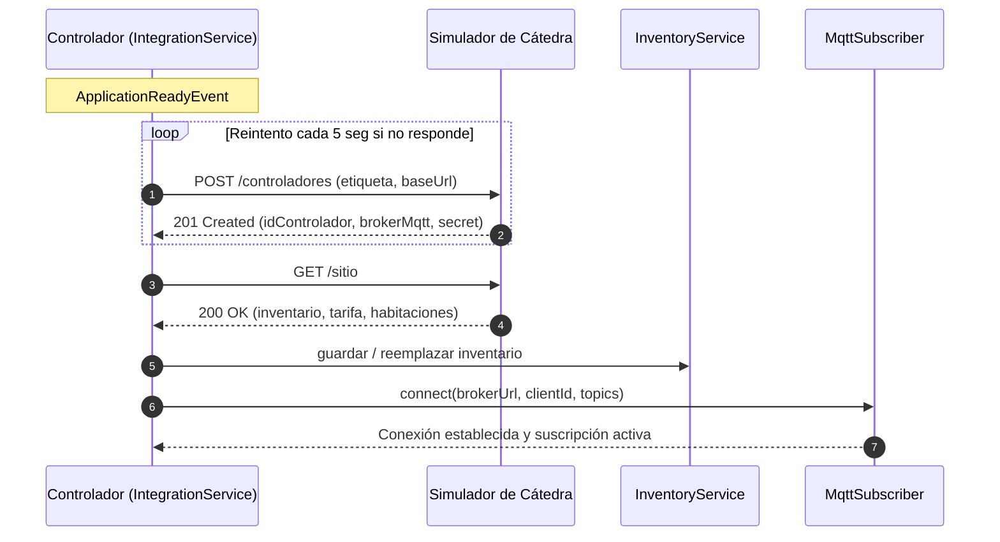
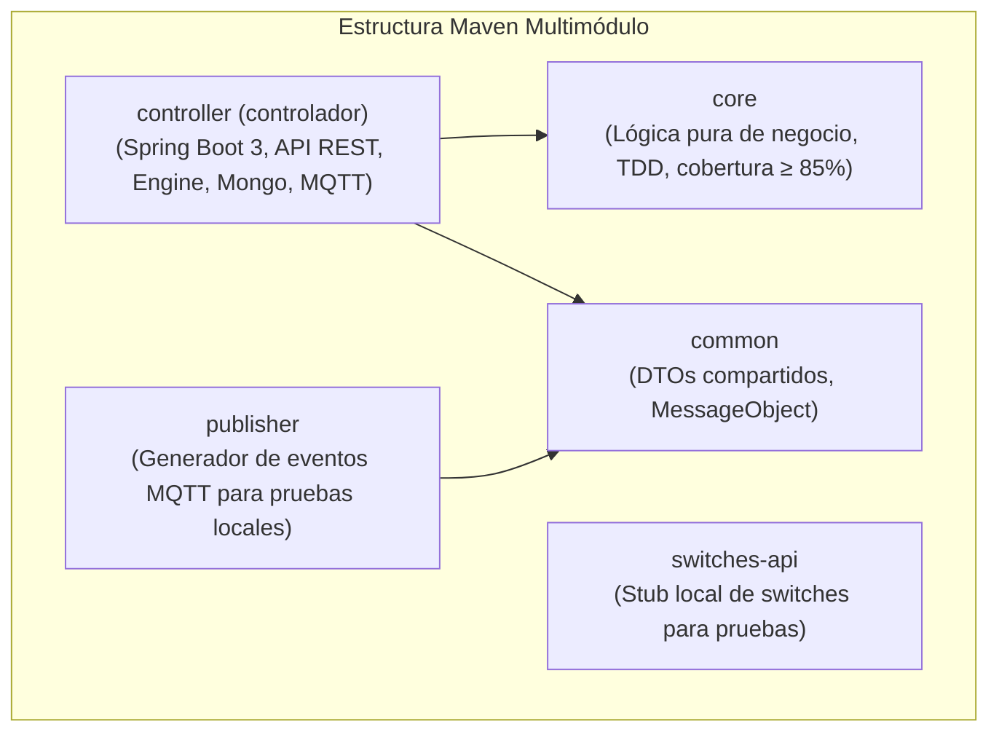
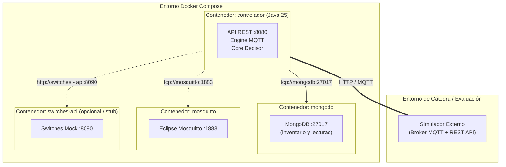
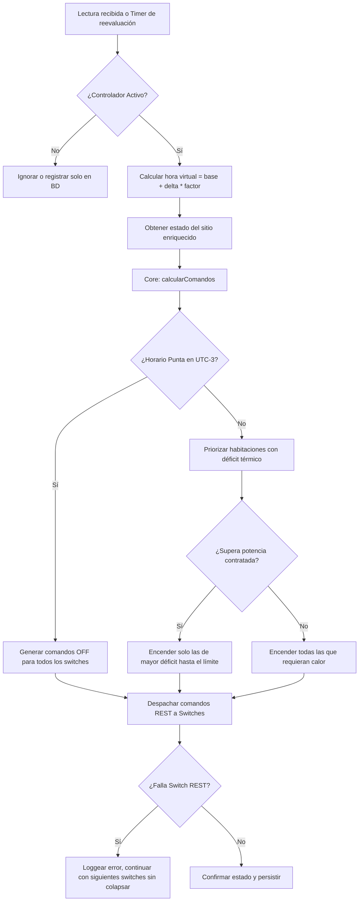

# Arquitectura 4+1 — EcoWarm (Iteración 5)

**Proyecto:** EcoWarm — Sistema de control de temperatura domótico  
**Grupo:** Grupo 2  
**Iteración:** 5 (Calidad, tiempo acelerado, resiliencia y cobertura)

---

## 1. Introducción y Contexto

El sistema EcoWarm tiene como propósito gestionar de forma automatizada y eficiente la climatización de un sitio (hogar
inteligente). Para la **Iteración 5**, la arquitectura evoluciona garantizando características clave de calidad y
resiliencia:

- Integración real y bidireccional entre el **Core de decisión** y el **Engine de control**.
- Soporte para **tiempo acelerado y virtualizado** (simulaciones con factor de aceleración $X$).
- Resiliencia y tolerancia a fallos: reconexión automática ante caídas de MQTT broker, indisponibilidad de la API REST
  de switches y control de límites de potencia contratada.
- Registro y actualización dinámica del inventario del sitio ante cambios durante la ejecución.

---

## 2. Vista Lógica

La arquitectura desacopla estrictamente la lógica de negocio pura de la infraestructura y comunicaciones.

### Componentes Principales:

1. **Core (`com.iiss.sensores.grupo_2`):**
    - **Independiente de infraestructura:** No contiene librerías web, bases de datos ni frameworks.
    - **Contrato principal:** `ICore.calcularComandos(ZonedDateTime fechaHora, DataSite dataSite) : CoreAnswer`.
    - **Reglas de negocio:**
        - *Tarifa Punta (`RushHour`):* Si el horario evaluado (en UTC-3) cae en franja punta de día hábil, emite orden
          de `APAGADO` para todos los switches activos.
        - *Liberación de potencia:* Apaga switches en habitaciones que alcanzaron o superaron la temperatura objetivo.
        - *Priorización por déficit:* Ordena habitaciones por mayor diferencia $(T_{esperada} - T_{actual})$ y enciende
          switches hasta el límite de `potenciaContratadaKW`.

2. **Engine / Controlador (`com.iiss.sensores.grupo_2.controlador`):**
    - **`ControllerTempAuto`:** Orquesta el ciclo de control. Administra el estado (`INICIAR` / `DETENER`), el factor de
      aceleración de tiempo y la conversión a zona horaria local (`America/Montevideo`). Invoca a `ICore` y despacha los
      comandos resultantes vía `SwitchClient`.
    - **`SiteStateService`:** Mantiene el estado en memoria, enriqueciendo las habitaciones con las últimas lecturas
      térmicas obtenidas desde MongoDB o memoria.
    - **`IntegrationService` y `MqttSubscriptionService`:** Registra automáticamente el controlador en el simulador al
      iniciar (`ApplicationReadyEvent`), obtiene la configuración del sitio y suscribe dinámicamente a los tópicos MQTT
      correspondientes.
    - **`MqttSubscriber`:** Cliente Eclipse Paho con reconexión automática (`AutomaticReconnect = true`) y
      sincronización ante desconexiones.
    - **`ReevaluationControlService`:** Tarea programada (`@Scheduled`) que reevalúa periódicamente el estado aunque no
      ingresen nuevas lecturas de sensores.

---

## 3. Vista de Procesos

La vista de procesos describe la concurrencia, sincronización e interacción ante eventos del simulador.

### Secuencia: Recepción de Lectura MQTT y Ciclo de Control

### Secuencia: Registro Inicial y Sincronización con el Simulador

---

## 4. Vista de Desarrollo

Organización estática de módulos Maven y responsabilidades en el repositorio:

### Distribución de Paquetes (`controlador`):

- `com.iiss.sensores.grupo_2.controlador.api`: Controladores REST (`EngineController`, `SiteController`,
  `RoomController`), entidades MongoDB y servicios de inventario.
- `com.iiss.sensores.grupo_2.controlador.engine.service`: `ControllerTempAuto`, `SiteStateService`,
  `ReevaluationControlService`.
- `com.iiss.sensores.grupo_2.controlador.engine.mqtt`: `MqttSubscriber` con manejo de callbacks de conexión y
  reconexión.
- `com.iiss.sensores.grupo_2.controlador.engine.client`: `SwitchClient` y configuración de `RestClient` HTTP con
  timeouts y manejo de errores.
- `com.iiss.sensores.grupo_2.controlador.integration`: `IntegrationService` y `MqttSubscriptionService`.

### Pruebas Automatizadas:

- **Unitarias TDD (`core`):** `CoreTest`, `RushHourTest` (cobertura superior al 85% requerida por la cátedra).
- **Integración (`controller/src/test/.../integration`):**
    - `ControlTempIntegrationIT`: Control bajo carga suficiente vs limitación efectiva de potencia.
    - `MqttResilienceIT`: Prueba de caída de broker Mosquitto en contenedor Testcontainers y reconexión transparente.
    - `SwitchClientRestFailureIT`: Validación ante timeouts o caídas del servicio REST de switches sin romper el loop de
      control.
    - `BigBangSystemIntegrationIT`: Prueba end-to-end con ciclo completo de arranque, simulación y parada.

---

## 5. Vista Física

Despliegue de nodos y contenedores Docker administrados por `docker/docker-compose.yml`:

- En modo standalone local, `mosquitto` y `switches-api` brindan soporte a las pruebas manuales.
- En modo evaluación/simulador, las variables `CONECTAR_CON_SIMULADOR=true`, `SIMULATOR_API_URL` y `MQTT_BROKER_URL`
  redirigen la conectividad hacia el entorno del simulador de la cátedra.

---

## 6. Escenarios (+1) — Casos de Calidad y Resiliencia (Iteración 5)

La vista de escenarios concreta cómo responde el sistema ante los casos de calidad exigidos:

### Casos de Calidad Validados:

1. **Factor de Aceleración de Tiempo:**  
   Al enviar comando `INICIAR` con `{ "fechaHora": "...", "factorTiempo": 10 }`, el controlador escala el transcurso de
   los minutos reales por 10 al interactuar con el Core, permitiendo simular días completos en minutos.
2. **Caída y Recuperación de MQTT:**  
   Ante la desconexión del broker, `MqttSubscriber` retiene los tópicos deseados en memoria y activa el mecanismo de
   reconexión automática de Paho. Al restablecerse la red, re-suscribe de inmediato sin requerir reinicio del
   contenedor.
3. **Falla en Switches REST:**  
   Si una habitación reporta fallo de red o error 5xx al intentar conmutar su switch, `ControllerTempAuto` aísla la
   excepción y prosigue aplicando los comandos del resto de los ambientes.
4. **Límite de Potencia Eléctrica:**  
   Si tres habitaciones necesitan calefacción simultánea pero encender las tres excede los kW contratados del sitio, el
   Core prioriza estrictamente las que se encuentran más lejos de su temperatura esperada, preservando la seguridad
   eléctrica del hogar.
