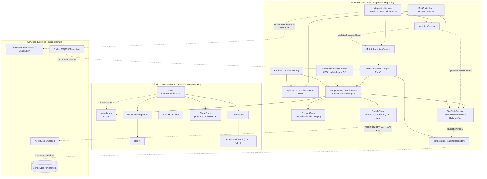
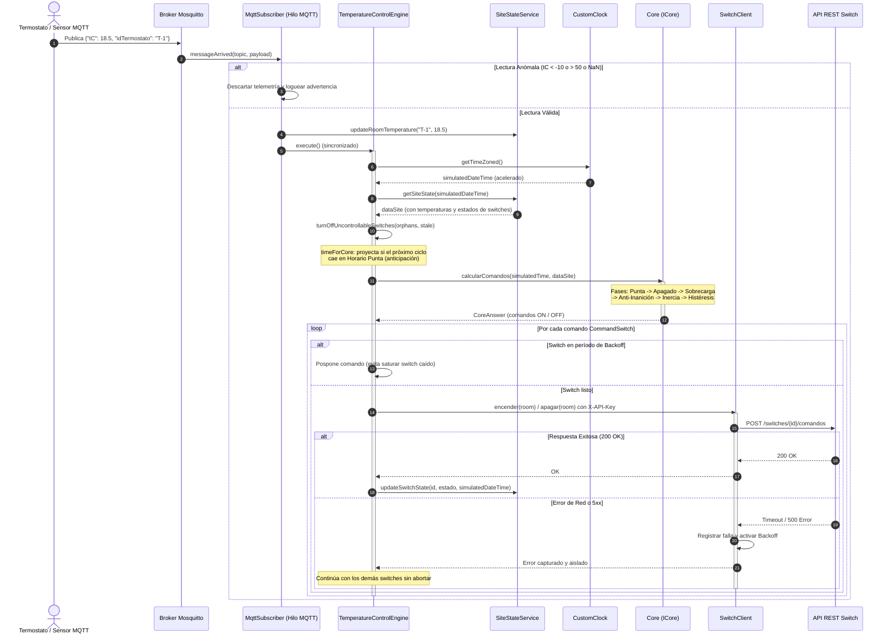
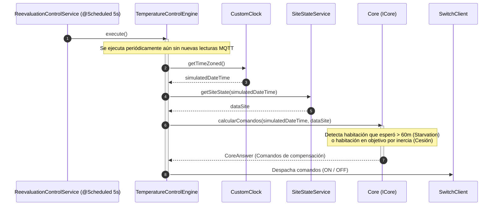
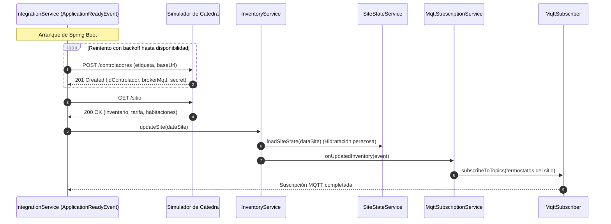
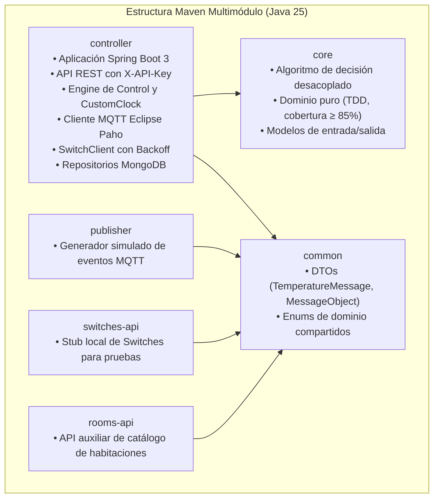
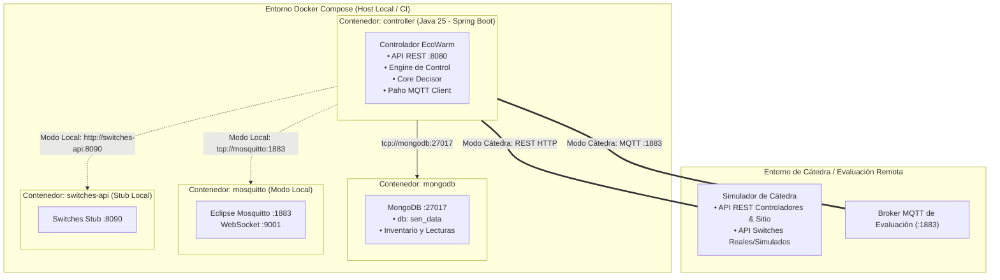
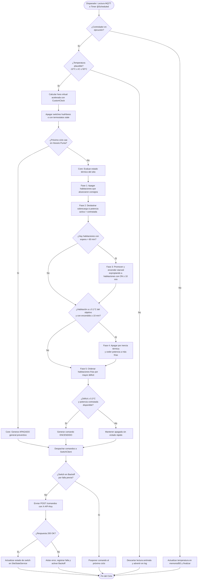

# Arquitectura 4+1 — EcoWarm (Versión Final del Sistema)

**Proyecto:** EcoWarm — Sistema de control de temperatura domótico  
**Grupo:** Grupo 2  
**Alcance:** Arquitectura de Producción / Entrega Final (Algoritmo Multi-fase, Anti-Starvation, Histéresis, Resiliencia y Tiempo Acelerado)

---

## 1. Introducción y Contexto

El sistema **EcoWarm** gestiona de forma autónoma, eficiente y segura la climatización por losa radiante de un sitio inteligente (hogares, oficinas o edificios). La arquitectura se fundamenta en un desacoplamiento estricto entre el motor de decisión algorítmico y la infraestructura de comunicaciones, incorporando mecanismos avanzados de control térmico y resiliencia ante contingencias del mundo real:

- **Algoritmo de Control en 6 Fases:** Gestión desacoplada que resuelve tarifa punta, deslastre de sobrecarga, habitaciones postergadas (*anti-starvation*), aprovechamiento de calor residual por inercia térmica, histéresis de encendido y priorización por déficit térmico bajo el límite estricto de potencia contratada ($kW$).
- **Tiempo Acelerado y Virtualizado con Lookahead:** Soporte para simulaciones de alta velocidad (factor de aceleración $X$) con proyección preventiva de ciclos para no iniciar calefacción justo antes de una tarifa punta.
- **Resiliencia Integral y Tolerancia a Fallos:** 
  - Reconexión transparente ante caídas del broker MQTT (Paho automático con persistencia de tópicos).
  - Circuito de *Backoff* y aislamiento de excepciones por dispositivo en la API REST de switches.
  - Fail-safe ante estados desconocidos (`DESCONOCIDO` $\rightarrow$ apagado forzado).
- **Seguridad Operacional Dinámica:** Apagado automático de switches huérfanos (habitaciones eliminadas/modificadas del inventario) y de switches con termostatos silenciosos (*stale* sin lecturas recientes).
- **Filtro de Telemetría Anómala:** Descarte de lecturas no plausibles ($< -10\ ^\circ\text{C}$ o $> 50\ ^\circ\text{C}$, NaN, infinitos).
- **Seguridad de Acceso:** Autenticación de endpoints y clientes mediante encabezado `X-API-Key`.

---

## 2. Vista Lógica

La vista lógica desglosa la funcionalidad del sistema en módulos altamente cohesivos y con acoplamiento débil, separando la lógica de decisión pura del framework de aplicación y los adaptadores de infraestructura.

### Componentes y Responsabilidades:

#### 1. Módulo Core (`core` — Java 25 puro):
- **Cero dependencias externas:** No depende de Spring, MQTT, HTTP ni bases de datos.
- **Contrato unificado:** `ICore.calcularComandos(ZonedDateTime fechaHora, DataSite dataSite) : CoreAnswer`.
- **Estrategia de Decisión en 6 Fases:**
  1. **Tarifa Punta (`RushHour`):** Apagado general preventivo si la hora evaluada corresponde a horario pico en día hábil (UTC-3).
  2. **Apagado de Satisfechas:** Apaga switches de habitaciones cuya temperatura actual alcanza o supera la esperada ($T_{actual} \ge T_{esperada}$), liberando potencia inmediatamente.
  3. **Deslastre de Sobrecarga (*Shed Overload*):** Si la potencia activa actual supera la contratada, apaga selectivamente las habitaciones menos necesitadas para evitar sobrecargas eléctricas.
  4. **Atención de Inanición (*Anti-Starvation*):** Si una habitación con switch apagado lleva más de `DEFAULT_MAX_WAIT` (60 min) esperando por debajo de su consigna, es promovida de forma prioritaria, pudiendo expropiar potencia a habitaciones activas que ya hayan cumplido su tiempo mínimo encendidas (`DEFAULT_MIN_ON_TIME` = 10 min).
  5. **Cesión por Inercia Térmica:** Si una habitación está muy cerca de su objetivo (a menos de $\Delta = 0.1\ ^\circ\text{C}$) y ya cumplió con el tiempo mínimo de encendido, apaga preventivamente su switch para ceder su potencia a habitaciones más frías, aprovechando el calor residual de la losa radiante.
  6. **Encendido por Déficit con Histéresis:** Ordena las habitaciones frías por mayor brecha térmica $(T_{esperada} - T_{actual})$. Solo se encienden aquellas que estén al menos `DEFAULT_TURN_ON_HYSTERESIS_C` ($0.3\ ^\circ\text{C}$) por debajo del objetivo (evitando ciclado rápido o *chattering*), y hasta el límite estricto de la potencia contratada del sitio.

#### 2. Módulo Controlador / Engine (`controller` — Spring Boot 3):
- **`TemperatureControlEngine`:** Corazón orquestador. Administra el ciclo de vida del controlador (`start` / `stop`), calcula el tiempo virtual con `CustomClock`, aplica el *lookahead* de tarifa punta (`timeForCore`), invoca el `ICore`, despacha los comandos a través de `SwitchClient` con manejo aislado de fallas, y comanda apagado de emergencia para switches huérfanos y estancados. Al detenerse el motor, apaga preventivamente todos los switches activos.
- **`SiteStateService`:** Mantiene el estado en memoria viva del sitio. Implementa hidratación perezosa (*lazy hydration*) desde MongoDB y la API de switches al inicio o ante modificaciones de inventario. Supervisa termostatos silenciosos (*stale* sin lecturas por $> 15$ min) y gestiona switches huérfanos (*orphans*).
- **`CustomClock`:** Encapsula la virtualización temporal, aplicando el factor de aceleración sobre el reloj base del sistema.
- **`SwitchClient`:** Cliente HTTP con soporte de `X-API-Key`, detección y mitigación de fallos vía *backoff* exponencial/progresivo (`SwitchInBackoffException`), y corrección de switches en estado `DESCONOCIDO` mediante orden inmediata de apagado.
- **`ReevaluationControlService`:** Disparador periódico (`@Scheduled` cada 5 s) que fuerza ciclos de evaluación en `TemperatureControlEngine`, asegurando que las reglas basadas en tiempo (expiración de esperas, inercia térmica y hora punta) se ejecuten puntualmente aunque ningún sensor envíe lecturas.

---

## 3. Vista de Procesos

La vista de procesos ilustra la concurrencia, el manejo de eventos asíncronos y la resiliencia operativa en los distintos hilos de ejecución.

### 3.1 Recepción de Lectura MQTT, Filtrado y Ciclo de Control

### 3.2 Reevaluación Periódica: Anti-Inanición e Inercia Térmica

### 3.3 Autoconfiguración y Registro con el Simulador Externo

---

## 4. Vista de Desarrollo

Muestra la modularización física del código fuente en Maven, la separación de responsabilidades y la estrategia de calidad.

### Distribución de Paquetes (`controller`):

- `com.iiss.sensores.grupo_2.controlador.api`:
  - `controller`: `EngineController`, `SiteController`, `RoomController`.
  - `config`: `ApiKeyRoom` (seguridad de endpoints mediante `X-API-Key`).
  - `service`: `InventoryService`, `RoomService`.
- `com.iiss.sensores.grupo_2.controlador.engine`:
  - `service`: `TemperatureControlEngine`, `SiteStateService`, `ReevaluationControlService`.
  - `client`: `SwitchClient`, `SwitchRestClientConfig` (timeouts y *backoff*).
  - `mqtt`: `MqttSubscriber` (manejo de conexión, desconexión y retención de tópicos).
  - `utils`: `CustomClock` (manejo de tiempo acelerado virtual).
  - `persistence`: `TemperatureReadingRepository` (acceso a MongoDB).
- `com.iiss.sensores.grupo_2.controlador.integration`:
  - `IntegrationService`: Registro inicial ante el simulador externo.
  - `MqttSubscriptionService`: Gestión dinámica de suscripción a tópicos MQTT.

### Estrategia de Pruebas Automatizadas:

- **Módulo `core` (Pruebas Unitarias TDD Puras):**
  - `CoreTest`: Cobertura exhaustiva de las 6 fases de decisión: tarifa punta, histéresis ($0.3\ ^\circ\text{C}$), inercia térmica temprana ($0.1\ ^\circ\text{C}$), *anti-starvation* (espera $> 60$ min, retención mínima de $10$ min), expropiación y deslastre de sobrecarga de potencia contratada.
  - Cobertura de código certificada con JaCoCo $> 85\%$.
- **Módulo `controller` (Pruebas de Integración con Testcontainers y Mocks):**
  - `ControlTempIntegrationIT`: Control bajo carga térmica y validación de conmutación.
  - `MqttResilienceIT`: Caída y reinicio dinámico de contenedor Mosquitto mediante Testcontainers, verificando reconexión transparente sin pérdida de suscripción.
  - `SwitchClientRestFailureIT`: Tolerancia a errores HTTP 500, timeouts y activación de *backoff* en switches sin interrumpir el control de los demás ambientes.
  - `ApiKeyTest`: Verificación de rechazo de peticiones no autenticadas (401 Unauthorized).

---

## 5. Vista Física / Despliegue

La vista física describe la topología de contenedores y nodos de ejecución. Admite dos perfiles de funcionamiento: **Modo Local Autónomo** (para desarrollo y pruebas de integración) y **Modo Simulación / Evaluación de Cátedra**.

- **Variables de Configuración (`.env.local` / `.env.dev`):**
  - `CONECTAR_CON_SIMULADOR`: Activa el modo evaluación contra la cátedra (`true`) o el entorno local de contenedores (`false`).
  - `SIMULATOR_API_URL` y `MQTT_BROKER_URL`: Endpoints configurables de la cátedra o locales.
  - `CONTROLLER_API_KEY` y `SWITCHES_API_KEY`: Claves criptográficas para asegurar los canales REST.

---

## 6. Vista de Escenarios (+1) — Casos de Calidad y Resiliencia

Los escenarios unen y validan las cuatro vistas anteriores a través del flujo integral de ejecución del ciclo de control:

### Síntesis de Casos de Calidad Validados:

1. **Eficiencia y Confort Térmico (Histéresis e Inercia):**  
   Se previene el desgaste de relés y switches gracias a la histéresis de $0.3\ ^\circ\text{C}$. A su vez, la banda de inercia de $0.1\ ^\circ\text{C}$ aprovecha la energía remanente acumulada en la losa radiante, liberando potencia para habitaciones con mayor déficit.
2. **Equidad y Prevención de Inanición (*Anti-Starvation*):**  
   Ninguna habitación queda desatendida indefinidamente debido a la limitación de potencia contratada. Cumplidos $60$ minutos de espera bajo la temperatura esperada, el motor expropia potencia a zonas activas con más de $10$ minutos de funcionamiento continuo.
3. **Resiliencia Operativa de Red y Dispositivos:**  
   - Si la red o el servicio de switches falla, el circuito de *Backoff* evita la degradación por reintentos masivos y aísla la falla para no interrumpir el control de los demás ambientes.
   - Ante lecturas de estado `DESCONOCIDO` en switches, se envía una orden fail-safe de apagado.
   - Si el broker Mosquitto se desconecta, el cliente Eclipse Paho reconecta y re-suscribe automáticamente a los tópicos retenidos en memoria sin requerir reinicio del sistema.
4. **Protección Preventiva de Tarifas Eléctricas:**  
   El motor proyecta el avance del tiempo acelerado (`timeForCore`) y evita encender calefactores segundos antes de la entrada a la tarifa punta de UTE, previniendo penalizaciones económicas innecesarias.
5. **Seguridad Operacional Dinámica:**  
   La detección de termostatos silenciosos (*stale* $> 15$ min) y switches huérfanos garantiza que ninguna losa radiante continúe consumiendo energía fuera de supervisión.
